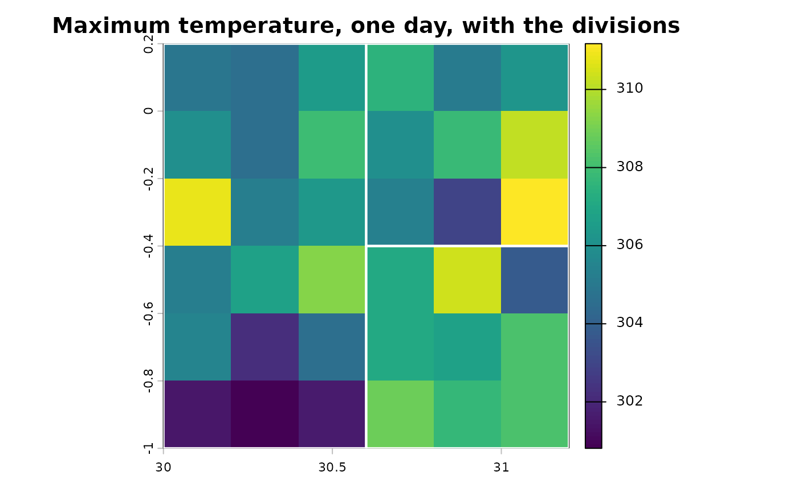

# Administrative divisions

When household coordinates are not available, or not precise enough, the
indicators are computed for the household’s administrative division:
every raster cell in the division contributes, weighted by the share of
the cell that lies inside it. This needs the `exactextractr` and `sf`
packages.

``` r

library(c4e)
```

## Reading the boundaries

[`read_boundaries()`](https://jmr-fao.github.io/c4e/reference/read_boundaries.md)
reads the FAO GAUL or geoBoundaries files of one or more countries and
returns the divisions with an `ID_adm_div` identifier. To keep this
article self-contained, it writes a miniature GAUL folder first, from
the three divisions that ship with the package.

``` r

root <- file.path(tempdir(), "gaul")
dir.create(file.path(root, "MWI", "MWI_ADM2"), recursive = TRUE, showWarnings = FALSE)
divisions <- terra::vect(system.file("extdata", "adm_div.gpkg", package = "c4e"))
# GAUL's own field names
terra::values(divisions) <- data.frame(iso3_code = "MWI",
                                       gaul1_name = divisions$adm_div_1,
                                       gaul2_name = divisions$adm_div_2)
terra::writeVector(divisions, file.path(root, "MWI", "MWI_ADM2", "MWI_ADM2.geojson"),
                   filetype = "GeoJSON", overwrite = TRUE)

adm <- read_boundaries(root, iso = "MWI", level = 2)
adm
#> class       : SpatVector
#> geometry    : polygons
#> dimensions  : 3, 4  (geometries, attributes)
#> extent      : 30, 31.2, -1, 0.2  (xmin, xmax, ymin, ymax)
#> source      : MWI_ADM2.geojson
#> coord. ref. : lon/lat WGS 84 (EPSG:4326)
#> names       : ID_adm_div   iso adm_div_1  adm_div_2
#> type        :      <chr> <chr>     <chr>      <chr>
#> values      :          1   MWI      West     West A
#>                        2   MWI      East East South
#>                        3   MWI      East East North
```

``` r

tmax <- read_climate(system.file("extdata", "tmax_daily.tif", package = "c4e"))
#> Read tmax_daily: tmax [K], daily, 2021-01-01 to 2023-12-31, 1095 layers
#> (synthetic).
terra::plot(tmax[[200]], main = "Maximum temperature, one day, with the divisions")
terra::plot(adm, add = TRUE, border = "white", lwd = 2)
```



## Cells of each division

[`extract_cell_by_poly()`](https://jmr-fao.github.io/c4e/reference/extract_cell_by_poly.md)
returns every cell of every division with the share of the cell inside
it (`coverage_fraction`). Indicators are then computed cell by cell,
exactly as for households.

``` r

cells <- extract_cell_by_poly(convert_unit(tmax, "C"), adm)
cells[1:3, 1:7]
#> # A tibble: 3 × 7
#> # Context:  tmax [C], day, wide; key ID_adm_div
#>   ID_adm_div x_cell y_cell coverage_fraction `2021-01-01` `2021-01-02`
#>   <chr>       <dbl>  <dbl>             <dbl>        <dbl>        <dbl>
#> 1 1            30.1    0.1                 1         18.7         19.8
#> 2 1            30.3    0.1                 1         20.8         18.2
#> 3 1            30.5    0.1                 1         17.0         22.5
#> # ℹ 1 more variable: `2021-01-03` <dbl>

hot <- calc_threshold_day(cells, above = 30)
#> Using `unit = "C"` from upstream unit.
```

## From cells to divisions

[`aggregate_to_adm()`](https://jmr-fao.github.io/c4e/reference/aggregate_to_adm.md)
takes the coverage-weighted mean over the cells of each division. A
daily flag becomes the share of the division’s area above the threshold
that day.

``` r

by_division <- aggregate_to_adm(hot)
head(by_division, 4)
#> # A tibble: 4 × 4
#> # Context:  tmax [C], day, long; key ID_adm_div; 2 indicators
#>   ID_adm_div date       day_abv_30 C_abv_30
#>   <chr>      <date>          <dbl>    <dbl>
#> 1 1          2021-01-01          0        0
#> 2 1          2021-01-02          0        0
#> 3 1          2021-01-03          0        0
#> 4 1          2021-01-04          0        0
```

The daily table can be summarised by year or month with
[`summarise_by_period()`](https://jmr-fao.github.io/c4e/reference/summarise_by_period.md),
for a panel of divisions:

``` r

summarise_by_period(by_division, "year")
#> # A tibble: 9 × 4
#> # Context:  tmax [C], year, long; key ID_adm_div; 2 indicators
#>   ID_adm_div period     day_abv_30_sum C_abv_30_sum
#>   <chr>      <date>              <dbl>        <dbl>
#> 1 1          2021-01-01           88.7         189.
#> 2 1          2022-01-01           88.7         185.
#> 3 1          2023-01-01           88.1         177.
#> 4 2          2021-01-01          133.          379.
#> 5 2          2022-01-01          134.          384.
#> 6 2          2023-01-01          134.          384.
#> 7 3          2021-01-01          133.          391.
#> 8 3          2022-01-01          130.          386.
#> 9 3          2023-01-01          135           395.
```

## Households in divisions

[`weather_extremes()`](https://jmr-fao.github.io/c4e/reference/weather_extremes.md)
does this in one call with `boundaries`: each household gets the
indicators of the division its coordinates fall in.

``` r

survey <- read.csv(system.file("extdata", "survey.csv", package = "c4e"))
survey$interview <- as.Date(survey$interview)

heat <- weather_extremes(survey, system.file("extdata", "tmax_daily.tif", package = "c4e"),
                         id = hhid, interview = interview, preset = "heat",
                         boundaries = adm, control = extremes_control(verbose = FALSE))
#> Loading one raster block of data per layer requires approximately 1095 MB but the GDAL block size cache is only 799 MB. This is likely to result in very slow performance. It is recommended to increase the cache size using terra::gdalCache(new_size), reduce the number of layers in the input raster, or rewrite the input raster using a smaller chunk size.
print(heat, n = 4)
#> # A tibble: 20 × 14
#> # Context:  tmax [C], day, summary; key hhid; 12 indicators
#>   hhid    lag day_abv_30_sum C_abv_30_sum day_abv_35_sum C_abv_35_sum
#>   <chr> <int>          <dbl>        <dbl>          <dbl>        <dbl>
#> 1 HH01      0           88.5         178.           3.72         3.05
#> 2 HH02      0          134.          384.          19.7         21.9 
#> 3 HH03      0           88.8         183.           4.11         3.30
#> 4 HH04      0           89.3         187.           4.67         3.43
#> # ℹ 16 more rows
#> # ℹ 8 more variables: spell_abv_30_max <dbl>, spell_abv_30_mean <dbl>,
#> #   spell_abv_30_sum <dbl>, spell_abv_30_n <int>, spell_abv_35_max <dbl>,
#> #   spell_abv_35_mean <dbl>, spell_abv_35_sum <dbl>, spell_abv_35_n <int>
```
