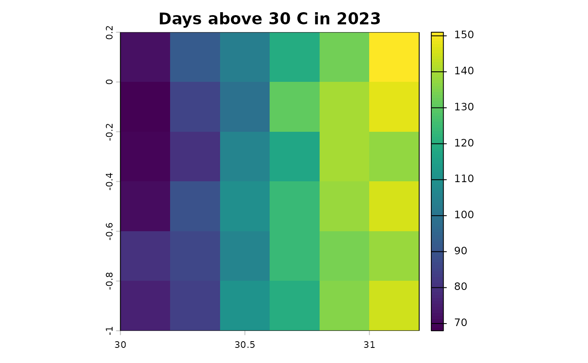

# Get started with c4e

c4e turns the location of each household and the date of its interview
into two kinds of variables an economist adds to a survey:

- **weather extremes** over the period before the interview: hot, cold,
  wet and dry days, their spells, heatwaves and drought indices;
- **spatial controls** for the place: terrain, zones, distances,
  population density and climate normals.

Each comes from one call. This page shows the six calls on the small
data that ship with the package; the articles take each one apart.

``` r

library(c4e)
```

## The data

A survey needs a household identifier, coordinates and an interview
date. The package ships 20 synthetic households at 12 locations,
interviewed in 2023, and rasters over the same area: daily maximum
temperature and precipitation for 2021 to 2023, and monthly
precipitation for 1984 to 2023.

``` r

survey <- read.csv(system.file("extdata", "survey.csv", package = "c4e"))
survey$interview <- as.Date(survey$interview)
head(survey)
#>   hhid     lon     lat  interview
#> 1 HH01 30.5199  0.0651 2023-08-01
#> 2 HH02 30.8762 -0.8786 2023-03-17
#> 3 HH03 30.4129 -0.3005 2023-06-19
#> 4 HH04 30.3817 -0.2026 2023-05-30
#> 5 HH05 30.7709 -0.3721 2023-04-16
#> 6 HH06 30.4325 -0.3434 2023-03-06

tmax <- system.file("extdata", "tmax_daily.tif", package = "c4e")
pre_daily <- system.file("extdata", "pre_daily.tif", package = "c4e")
pre_monthly <- system.file("extdata", "pre_monthly.tif", package = "c4e")
```

## Weather extremes before each interview

[`weather_extremes()`](https://jmr-fao.github.io/c4e/reference/weather_extremes.md)
runs the whole chain: it places the households, reads the raster,
extracts the days at each location, flags the extremes, finds their
spells and summarises them over the year before each interview. A preset
picks the indicators;
[`list_presets()`](https://jmr-fao.github.io/c4e/reference/list_presets.md)
shows them all.

``` r

list_presets()[c("preset", "variable", "spec")]
#> # A tibble: 10 × 3
#>    preset        variable spec                                  
#>    <chr>         <chr>    <chr>                                 
#>  1 heavy_rain    pre      above = c(20, 50)                     
#>  2 wet_days_p95  pre      p = c(0.95, 0.99), exclude_below = 0.1
#>  3 dry_spell     pre      below = 1, min_spell = 5              
#>  4 dry_days_p10  pre      p = 0.1, exclude_below = 0.1          
#>  5 heat          tmax     above = c(30, 35)                     
#>  6 heatwave_wmo  tmax     heatwave excess = 5                   
#>  7 hot_days_p90  tmax     p = c(0.9, 0.95)                      
#>  8 cold          tmin     below = c(0, -5)                      
#>  9 cold_days_p10 tmin     p = c(0.1, 0.05)                      
#> 10 drought_spi3  pre      below = c(-1, -1.5, -2), spi scale = 3
```

The temperature raster is in kelvin; the `heat` preset reads its
thresholds in Celsius, so the data are converted first, and the history
says so.

``` r

heat <- weather_extremes(survey, tmax, id = hhid, interview = interview,
                         preset = "heat")
print(heat, n = 5)
#> # A tibble: 20 × 14
#> # Context:  tmax [C], day, summary; key hhid; 12 indicators
#>   hhid    lag day_abv_30_sum C_abv_30_sum day_abv_35_sum C_abv_35_sum
#>   <chr> <int>          <dbl>        <dbl>          <dbl>        <dbl>
#> 1 HH01      0            103         235.              4         1.84
#> 2 HH02      0            140         419.             28        24.6 
#> 3 HH03      0            105         233.              5         4.38
#> 4 HH04      0             81         153.              3         1.39
#> 5 HH05      0            121         277.             14         9.52
#> # ℹ 15 more rows
#> # ℹ 8 more variables: spell_abv_30_max <dbl>, spell_abv_30_mean <dbl>,
#> #   spell_abv_30_sum <dbl>, spell_abv_30_n <int>, spell_abv_35_max <dbl>,
#> #   spell_abv_35_mean <dbl>, spell_abv_35_sum <dbl>, spell_abv_35_n <int>
```

`day_abv_30_sum` is the number of days above 30 C in the year before the
interview, `spell_abv_30_max` the longest run of them. Every table can
print the steps that produced it, ready to copy and adapt:

``` r

c4e_history(heat)
#> <c4e history: 6 steps, 0.5 s>
#> prepare_coord(id_rule = "coordinates") |>                                                                    # 0.1 s
#>   extract_by_coord() |>                                                                                      # 0.0 s
#>   convert_unit(to = "C", from = "K") |>                                                                      # 0.1 s
#>   calc_threshold_day(above = c(30, 35), unit = "C") |>                                                       # 0.1 s
#>   calc_spell(min_spell = 2L) |>                                                                              # 0.0 s
#>   summarise_by_interview(window = list(type = "lag", interval = "1 year", n_lags = 0L), min_coverage = 0.8)  # 0.1 s
```

## Drought before each interview

[`climate_indices()`](https://jmr-fao.github.io/c4e/reference/climate_indices.md)
computes the standardised precipitation index (SPI) on monthly
precipitation, or the SPEI when evapotranspiration is given, and counts
the months below drought thresholds. Here, the three-month SPI over the
six months before each interview:

``` r

drought <- climate_indices(survey, pre_monthly, id = hhid, interview = interview,
                           preset = "drought_spi3",
                           window = window_lag("6 months"))
print(drought, n = 5)
#> # A tibble: 20 × 6
#> # Context:  pre [mm/month], month, summary; key hhid; 4 indicators
#>   hhid    lag spi_3_mean `spi3_blw_-1_sum` `spi3_blw_-1.5_sum` `spi3_blw_-2_sum`
#>   <chr> <int>      <dbl>             <dbl>               <dbl>             <dbl>
#> 1 HH01      0     0.478                  0                   0                 0
#> 2 HH02      0    -1.70                   6                   4                 1
#> 3 HH03      0    -0.0555                 0                   0                 0
#> 4 HH04      0     1.07                   0                   0                 0
#> 5 HH05      0     0.444                  0                   0                 0
#> # ℹ 15 more rows
```

## Spatial controls

[`static_controls()`](https://jmr-fao.github.io/c4e/reference/static_controls.md)
summarises layers that do not change: here an elevation raster, from
which slope, the terrain ruggedness index and roughness are derived, and
a zone raster, which is never averaged. Each radius adds a set of
columns.

``` r

template <- terra::rast(tmax)[[1]]
elevation <- terra::rast(template, vals = seq(500, 1550, length.out = 36))
zones <- terra::rast(template, vals = rep(1:3, 12))

static <- static_controls(survey, list(elevation = elevation, aez = zones),
                          id = hhid, buffer = c(0, 20000))
print(static, n = 5)
#> # A tibble: 20 × 11
#> # Context:  summary; key hhid; 10 indicators
#>   hhid  elevation   aez slope   TRI roughness elevation_20km aez_20km slope_20km
#>   <chr>     <dbl> <dbl> <dbl> <dbl>     <dbl>          <dbl>    <dbl>      <dbl>
#> 1 HH01        560     3 0.473  142.       420            650        3      0.473
#> 2 HH02       1520     2 0.473  142.       420           1450        2      0.473
#> 3 HH03        920     3 0.473  142.       420            905        2      0.473
#> 4 HH04        890     2 0.473  142.       420            815        2      0.473
#> 5 HH05        950     1 0.473  142.       420           1020        1      0.473
#> # ℹ 15 more rows
#> # ℹ 2 more variables: TRI_20km <dbl>, roughness_20km <dbl>
```

[`time_varying_controls()`](https://jmr-fao.github.io/c4e/reference/time_varying_controls.md)
takes, for each household, the layer of the year that matches its
survey, here the population of the year before, and the climate normals
of the years before the survey:

``` r

pop <- terra::rast(template, nlyrs = 3, vals = rep(c(100, 200, 300), each = 36))
terra::time(pop) <- as.Date(c("2021-01-01", "2022-01-01", "2023-01-01"))

controls <- time_varying_controls(survey, list(pop = pop), id = hhid,
                                  interview = interview, match = "previous_year",
                                  climate = list(tmax = tmax), years = 30,
                                  stats = c("mean", "sd"))
print(controls, n = 5)
#> # A tibble: 20 × 7
#> # Context:  summary; key hhid; 4 indicators
#>   hhid  survey_year   pop pop_year pop_density tmax_mean tmax_sd
#>   <chr>       <int> <dbl>    <int>       <dbl>     <dbl>   <dbl>
#> 1 HH01         2023   200     2022       0.406      300.    4.73
#> 2 HH02         2023   200     2022       0.406      301.    4.65
#> 3 HH03         2023   200     2022       0.406      300.    4.67
#> 4 HH04         2023   200     2022       0.406      299.    4.71
#> 5 HH05         2023   200     2022       0.406      300.    4.68
#> # ℹ 15 more rows
```

## Every cell of a raster

The same indicators can be computed for every cell, per year or month,
for maps and grid panels.
[`grid_indicators()`](https://jmr-fao.github.io/c4e/reference/grid_indicators.md)
returns a raster with one layer per indicator and year:

``` r

hot_years <- grid_indicators(tmax, preset = "heat", spells = FALSE)
names(hot_years)
#>  [1] "day_abv_30_sum_2021" "day_abv_30_sum_2022" "day_abv_30_sum_2023"
#>  [4] "C_abv_30_sum_2021"   "C_abv_30_sum_2022"   "C_abv_30_sum_2023"  
#>  [7] "day_abv_35_sum_2021" "day_abv_35_sum_2022" "day_abv_35_sum_2023"
#> [10] "C_abv_35_sum_2021"   "C_abv_35_sum_2022"   "C_abv_35_sum_2023"
terra::plot(hot_years[["day_abv_30_sum_2023"]],
            main = "Days above 30 C in 2023")
```



[`grid_controls()`](https://jmr-fao.github.io/c4e/reference/grid_controls.md)
does the same for controls, such as the population density within a
radius:

``` r

density <- grid_controls(pop = pop[[3]], radius_m = c(0, 50000))
names(density)
#> [1] "pop_density"      "pop_density_50km"
```

## Export to Stata

[`write_stata()`](https://jmr-fao.github.io/c4e/reference/write_stata.md)
writes a `.dta` file with a label on every variable, built from what
each column measures, and optionally a codebook:

``` r

path <- file.path(tempdir(), "heat.dta")
write_stata(heat, path, codebook = TRUE)
c4e_labels(heat)[1:4]
#>                               day_abv_30_sum 
#>         "days above 30 C, per 1-year window" 
#>                                 C_abv_30_sum 
#> "total excess above 30 C, per 1-year window" 
#>                               day_abv_35_sum 
#>         "days above 35 C, per 1-year window" 
#>                                 C_abv_35_sum 
#> "total excess above 35 C, per 1-year window"
```

## Where next

- *Household extremes, step by step* takes
  [`weather_extremes()`](https://jmr-fao.github.io/c4e/reference/weather_extremes.md)
  apart.
- *Relative extremes* uses percentiles instead of fixed thresholds.
- *Administrative divisions* computes the indicators by district.
- *Drought indices* covers the SPI and SPEI in detail.
- *Climatic parameters and spatial controls* builds controls by hand.
- *Grid indicators and maps* works on every cell of a raster.

For a project with several steps and large files, the
[targets](https://docs.ropensci.org/targets/) package reruns only what
changed. A `_targets.R` for the chain above:

``` r

library(targets)
tar_option_set(packages = "c4e")

list(
    tar_target(survey_file, "data/survey.csv", format = "file"),
    tar_target(survey, {
        s <- read.csv(survey_file)
        s$interview <- as.Date(s$interview)
        s
    }),
    tar_target(tmax_file, "data/tmax_daily.tif", format = "file"),
    tar_target(heat, weather_extremes(survey, tmax_file, id = hhid,
                                      interview = interview, preset = "heat")),
    tar_target(heat_dta, {
        write_stata(heat, "output/heat.dta", codebook = TRUE)
        "output/heat.dta"
    }, format = "file")
)
```
