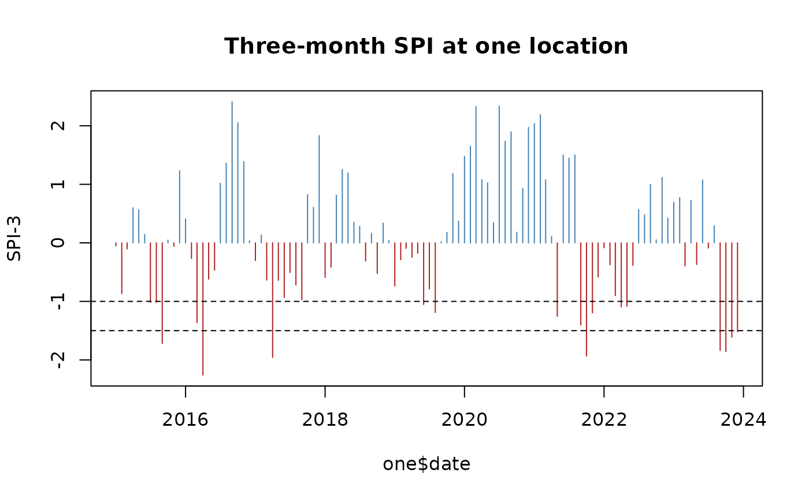

# Drought indices: SPI and SPEI

The standardised precipitation index (SPI) says how unusual the
precipitation of the last months is, in standard deviations, compared
with the same months in other years at the same place. An SPI of -1.5
over three months means a dry spell of a severity seen about once every
15 years. The SPEI does the same with the water balance: precipitation
minus potential evapotranspiration.

``` r

library(c4e)

survey <- read.csv(system.file("extdata", "survey.csv", package = "c4e"))
survey$interview <- as.Date(survey$interview)
coord <- prepare_coord(survey, lat_var = lat, lon_var = lon,
                       id = hhid, interview = interview)
```

## Monthly data, a long series

The indices need monthly data and many years: the package ships forty
years of monthly precipitation. Daily data are first summed to months
with
[`aggregate_time()`](https://jmr-fao.github.io/c4e/reference/aggregate_time.md).

``` r

pre <- read_climate(system.file("extdata", "pre_monthly.tif", package = "c4e"))
#> Read pre_monthly: pre [mm/month], monthly, 1984-01-01 to 2023-12-01, 480 layers
#> (synthetic).
raster_meta(pre)[c("variable", "unit", "time_step", "date_range")]
#> $variable
#> [1] "pre"
#> 
#> $unit
#> [1] "mm/month"
#> 
#> $time_step
#> [1] "month"
#> 
#> $date_range
#> [1] "1984-01-01" "2023-12-01"
extracted <- extract_by_coord(pre, georef_coord(coord))
#> Taking the coordinates as longitude and latitude in "EPSG:4326"; give `crs`
#> otherwise.
```

## The index

[`calc_std_index()`](https://jmr-fao.github.io/c4e/reference/calc_std_index.md)
fits the index at one or more accumulation scales, in months. Each
series is fitted on its own location’s history.

``` r

spi <- calc_std_index(extracted, scale = c(3, 12))
dplyr::filter(spi, ID == ID[1], date >= as.Date("2022-01-01")) |> head(6)
#> # A tibble: 6 × 7
#> # Context:  pre [mm/month], month, long; key ID; 2 indicators
#>   ID                x_cell y_cell date       value   spi_3  spi_12
#>   <chr>              <dbl>  <dbl> <date>     <dbl>   <dbl>   <dbl>
#> 1 30.27330_-0.11150   30.3   -0.1 2022-01-01  23.3 -0.0834  0.459 
#> 2 30.27330_-0.11150   30.3   -0.1 2022-02-01  12.1 -0.374   0.141 
#> 3 30.27330_-0.11150   30.3   -0.1 2022-03-01  22.7 -0.899  -0.162 
#> 4 30.27330_-0.11150   30.3   -0.1 2022-04-01  57.4 -1.09    0.0606
#> 5 30.27330_-0.11150   30.3   -0.1 2022-05-01  56.3 -1.08    0.203 
#> 6 30.27330_-0.11150   30.3   -0.1 2022-06-01 127.  -0.384  -1.37
```

``` r

one <- dplyr::filter(spi, ID == ID[1], date >= as.Date("2015-01-01"))
plot(one$date, one$spi_3, type = "h", col = ifelse(one$spi_3 < 0, "firebrick", "steelblue"),
     xlab = NULL, ylab = "SPI-3", main = "Three-month SPI at one location")
abline(h = c(-1, -1.5), lty = 2)
```



## Drought months and spells

[`calc_std_threshold()`](https://jmr-fao.github.io/c4e/reference/calc_std_threshold.md)
flags the months beyond index thresholds. The sign stays in the column
name, so `spi3_blw_-1.5` is the months with a three-month SPI below
-1.5. The flags work with spells like any other.

``` r

dry <- calc_std_threshold(spi, below = c(-1, -1.5))
dry <- calc_spell(dry, min_spell = 2)
names(dry)
#>  [1] "ID"                   "x_cell"               "y_cell"              
#>  [4] "date"                 "value"                "spi_3"               
#>  [7] "spi_12"               "spi3_blw_-1"          "spi3_blw_-1.5"       
#> [10] "spi12_blw_-1"         "spi12_blw_-1.5"       "spell_spi3_blw_-1"   
#> [13] "spell_spi3_blw_-1.5"  "spell_spi12_blw_-1"   "spell_spi12_blw_-1.5"
```

## Before each interview

``` r

summary <- summarise_by_interview(coord, dry, window = window_lag("1 year"))
print(summary, n = 4)
#> # A tibble: 20 × 24
#> # Context:  pre [mm/month], month, summary; key hhid; 22 indicators
#>   hhid    lag spi_3_mean spi_12_mean `spi3_blw_-1_sum` `spi3_blw_-1.5_sum`
#>   <chr> <int>      <dbl>       <dbl>             <dbl>               <dbl>
#> 1 HH01      0     0.0497      -0.671                 1                   0
#> 2 HH02      0    -0.703        0.358                 6                   4
#> 3 HH03      0     0.234        0.444                 0                   0
#> 4 HH04      0     0.595       -0.357                 0                   0
#> # ℹ 16 more rows
#> # ℹ 18 more variables: `spi12_blw_-1_sum` <dbl>, `spi12_blw_-1.5_sum` <dbl>,
#> #   `spell_spi3_blw_-1_max` <dbl>, `spell_spi3_blw_-1_mean` <dbl>,
#> #   `spell_spi3_blw_-1_sum` <dbl>, `spell_spi3_blw_-1_n` <int>,
#> #   `spell_spi3_blw_-1.5_max` <dbl>, `spell_spi3_blw_-1.5_mean` <dbl>,
#> #   `spell_spi3_blw_-1.5_sum` <dbl>, `spell_spi3_blw_-1.5_n` <int>,
#> #   `spell_spi12_blw_-1_max` <dbl>, `spell_spi12_blw_-1_mean` <dbl>, …
c4e_labels(summary)[c("spi_3_mean", "spi3_blw_-1.5_sum")]
#>                                        spi_3_mean 
#>    "mean of SPI over 3 months, per 1-year window" 
#>                                 spi3_blw_-1.5_sum 
#> "months with SPI-3 below -1.5, per 1-year window"
```

## The SPEI

With potential evapotranspiration, the same function gives the SPEI.
Here a constant 60 mm a month stands in for it; ERA5 records
evapotranspiration as a negative number, and either sign is accepted.

``` r

pet <- dplyr::mutate(extracted, dplyr::across(dplyr::matches("^\\d{4}-"), \(v) v * 0 + 60))
spei <- calc_std_index(extracted, scale = 3, index = "spei", pet = pet)
#> Water balance: precipitation minus the absolute evapotranspiration.
names(spei)
#> [1] "ID"     "x_cell" "y_cell" "date"   "value"  "spei_3"
```

## In one call

[`climate_indices()`](https://jmr-fao.github.io/c4e/reference/climate_indices.md)
runs the chain from the survey and the raster; daily precipitation is
summed to months by itself.

``` r

drought <- climate_indices(survey, system.file("extdata", "pre_monthly.tif", package = "c4e"),
                           id = hhid, interview = interview, scale = c(3, 12),
                           control = indices_control(verbose = FALSE))
print(drought, n = 4)
#> # A tibble: 20 × 10
#> # Context:  pre [mm/month], month, summary; key hhid; 8 indicators
#>   hhid    lag spi_3_mean spi_12_mean `spi3_blw_-1_sum` `spi3_blw_-1.5_sum`
#>   <chr> <int>      <dbl>       <dbl>             <dbl>               <dbl>
#> 1 HH01      0     NA          NA                    NA                  NA
#> 2 HH02      0     -1.32       -0.201                 1                   0
#> 3 HH03      0      0.195       0.393                 0                   0
#> 4 HH04      0      0.226       0.811                 0                   0
#> # ℹ 16 more rows
#> # ℹ 4 more variables: `spi3_blw_-2_sum` <dbl>, `spi12_blw_-1_sum` <dbl>,
#> #   `spi12_blw_-1.5_sum` <dbl>, `spi12_blw_-2_sum` <dbl>
```
