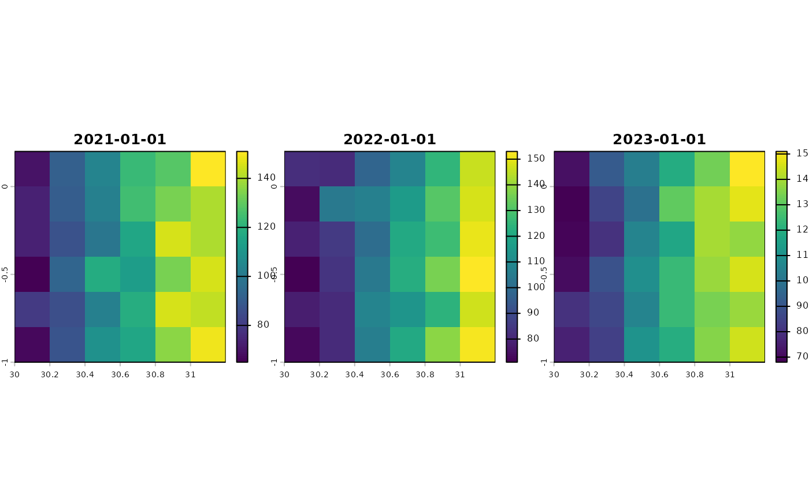
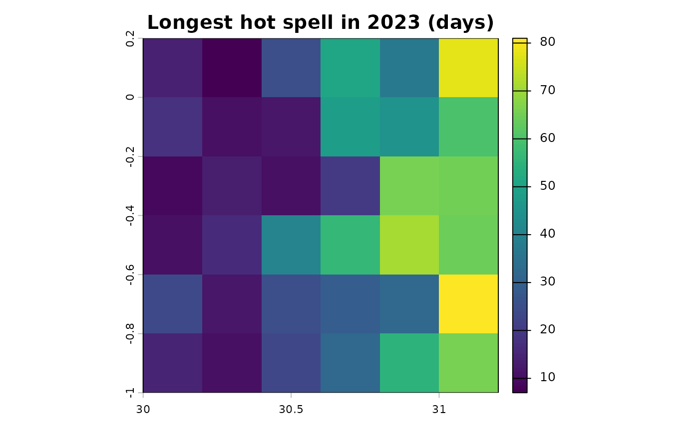
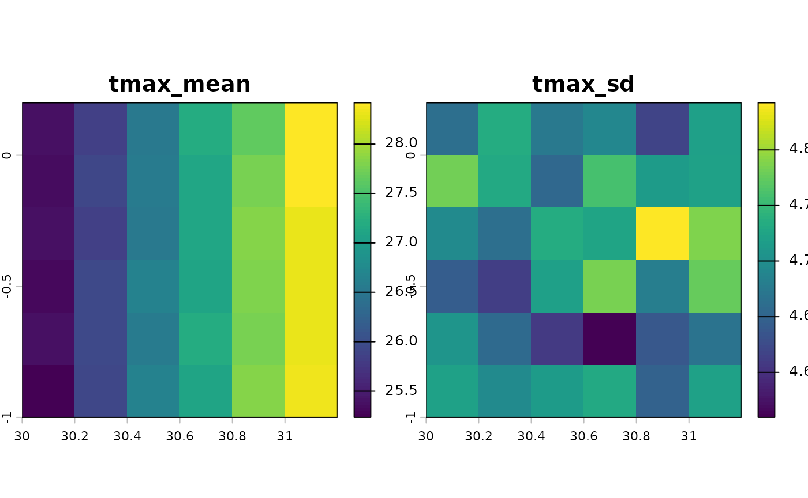
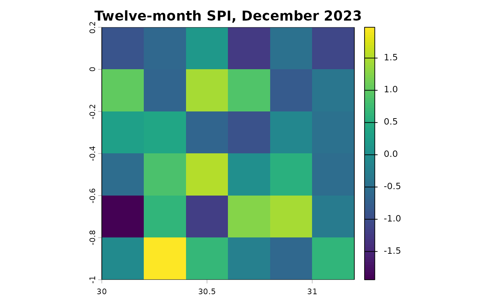
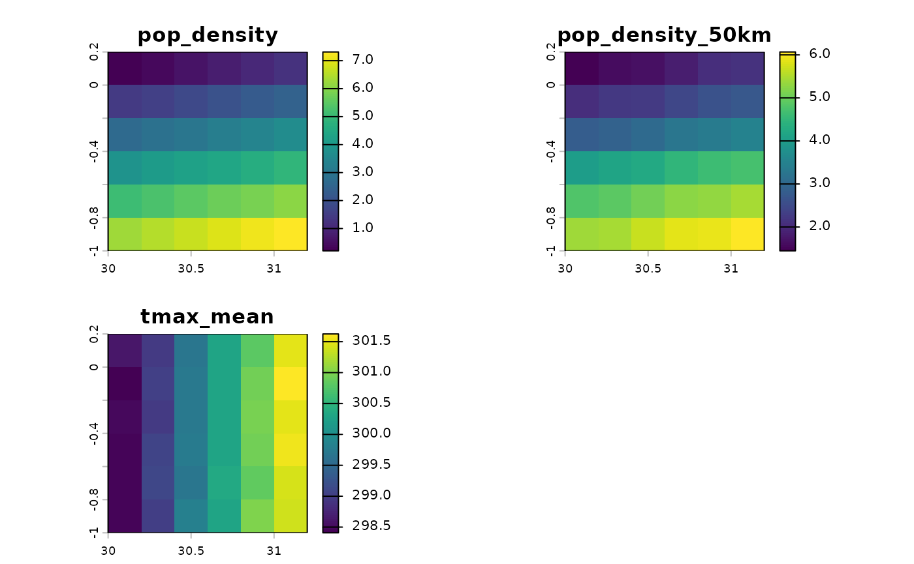

# Grid indicators and maps

The indicators can be computed for every cell of a raster rather than at
survey locations: for maps, for panels of grid cells or divisions, or to
compute once and extract at many surveys. The results are rasters with
one layer per indicator and period.

``` r

library(c4e)
tmax <- read_climate(system.file("extdata", "tmax_daily.tif", package = "c4e"))
#> Read tmax_daily: tmax [K], daily, 2021-01-01 to 2023-12-31, 1095 layers
#> (synthetic).
```

## Days beyond a threshold, per year

The step functions take a raster as well as a table.
[`calc_threshold_day()`](https://jmr-fao.github.io/c4e/reference/calc_threshold_day.md)
on a raster counts the days beyond each threshold per year (or month)
and sums their excess:

``` r

hot <- calc_threshold_day(convert_unit(tmax, "C"), above = 30)
names(hot)
#> [1] "day_abv_30_sum_2021" "day_abv_30_sum_2022" "day_abv_30_sum_2023"
#> [4] "C_abv_30_sum_2021"   "C_abv_30_sum_2022"   "C_abv_30_sum_2023"
terra::plot(hot[[grep("^day_abv_30", names(hot))]], nc = 3)
```



## Extremes with spells, in one call

[`grid_indicators()`](https://jmr-fao.github.io/c4e/reference/grid_indicators.md)
is the grid counterpart of
[`weather_extremes()`](https://jmr-fao.github.io/c4e/reference/weather_extremes.md),
with the same presets:

``` r

heat <- grid_indicators(tmax, preset = "heat", control = extremes_control(verbose = FALSE))
length(names(heat))
#> [1] 36
terra::plot(heat[["spell_abv_30_max_2023"]], main = "Longest hot spell in 2023 (days)")
```



The raster is processed in blocks of rows, so stacks larger than memory
can be handled; with `filename`, the result is written to a GeoTIFF as
it goes.

## The context travels with the file

The layers keep their dates and units, and the indicator registry is
kept in the GeoTIFF’s tags. Extracting the grid at survey locations
gives the same table as the table path, registry included:

``` r

path <- file.path(tempdir(), "heat.tif")
terra::writeRaster(heat, path, overwrite = TRUE)

survey <- read.csv(system.file("extdata", "survey.csv", package = "c4e"))
points <- georef_coord(prepare_coord(survey, lat_var = lat, lon_var = lon))
#> Taking the coordinates as longitude and latitude in "EPSG:4326"; give `crs`
#> otherwise.
from_file <- extract_by_coord(terra::rast(path), points)
head(from_file, 3)
#> # A tibble: 3 × 16
#> # Context:  tmax [C], year, long; key ID; 12 indicators
#>   ID         x_cell y_cell period     day_abv_30_sum C_abv_30_sum day_abv_35_sum
#>   <chr>       <dbl>  <dbl> <date>              <dbl>        <dbl>          <dbl>
#> 1 30.27330_…   30.3   -0.1 2021-01-01             90         183.              4
#> 2 30.27330_…   30.3   -0.1 2022-01-01            104         196.              5
#> 3 30.27330_…   30.3   -0.1 2023-01-01             85         169.              1
#> # ℹ 9 more variables: C_abv_35_sum <dbl>, spell_abv_30_max <dbl>,
#> #   spell_abv_30_mean <dbl>, spell_abv_30_sum <dbl>, spell_abv_30_n <dbl>,
#> #   spell_abv_35_max <dbl>, spell_abv_35_mean <dbl>, spell_abv_35_sum <dbl>,
#> #   spell_abv_35_n <dbl>
c4e_labels(from_file)[["spell_abv_30_max"]]
#> [1] "longest spell above 30 C (2+ days)"
```

## Statistics and indices per cell

[`calc_par()`](https://jmr-fao.github.io/c4e/reference/calc_par.md)
gives each cell’s statistics,
[`calc_percentile()`](https://jmr-fao.github.io/c4e/reference/calc_percentile.md)
its percentiles by month, and
[`calc_std_index()`](https://jmr-fao.github.io/c4e/reference/calc_std_index.md)
its SPI:

``` r

normals <- calc_par(convert_unit(tmax, "C"), fn = c("mean", "sd"))
terra::plot(normals)
```



``` r

pre <- read_climate(system.file("extdata", "pre_monthly.tif", package = "c4e"))
#> Read pre_monthly: pre [mm/month], monthly, 1984-01-01 to 2023-12-01, 480 layers
#> (synthetic).
spi <- calc_std_index(pre, scale = 12)
terra::plot(spi[["spi_12_2023-12"]], main = "Twelve-month SPI, December 2023")
```



## Controls per cell

[`grid_controls()`](https://jmr-fao.github.io/c4e/reference/grid_controls.md)
computes the population density within a radius (people per square
kilometre of land), climate normals and other layers, as one raster:

``` r

template <- tmax[[1]]
terra::time(template) <- NULL
pop <- terra::rast(template, vals = seq(100, 3600, by = 100))

controls <- grid_controls(pop = pop, radius_m = c(0, 50000),
                          climate = list(tmax = tmax), years = 2, stats = "mean",
                          control = controls_control(verbose = FALSE))
terra::plot(controls)
```


